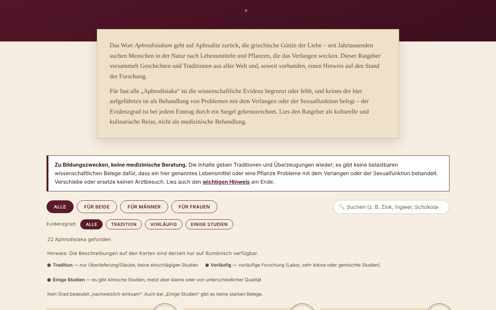

# Afrodisiace fără frontiere

[English](README.md) · [Română](README.ro.md) · [Français](README.fr.md) · [Italiano](README.it.md) · [Español](README.es.md) · [Português](README.pt.md) · **Deutsch** · [Magyar](README.hu.md)

**Version:** 2.0.0 · **Zuletzt aktualisiert:** 2026-10-26

Oberflächensprachen: **Română, English, Français, Italiano, Español, Português (PT), Deutsch, Magyar**

Kulturelles und botanisches Kompendium über 22 Lebensmittel und Pflanzen, die traditionell mit Begehren in Verbindung gebracht werden, mit der Angabe des Evidenzniveaus bei jedem Eintrag. Eine einzige HTML-Datei, offline.

**Live:** https://chiuta.github.io/Afrodisiace-fara-frontiere/

## Was es ist

Ein Bildungs- und Kulturführer: 22 Einträge (10 für beide, 6 für Männer, 6 für Frauen), jeweils mit einer kurzen Geschichte/Tradition und einem Siegel für das Evidenzniveau: „Tradition“, „Vorläufig“ oder „Einige Studien“. Keine Stufe bedeutet „nachweislich wirksam“. Es ist keine medizinische Beratung.

## Funktionen

- Liste mit 22 Einträgen, filterbar nach Zielgruppe (Alle / Für beide / Für Männer / Für Frauen).
- Zusätzlicher Filter nach Evidenzniveau (Tradition / Vorläufig / Einige Studien), kombinierbar mit Zielgruppe und Suche; Schaltfläche „Filter zurücksetzen“, wenn es keine Ergebnisse gibt; die Taste `/` setzt den Cursor in die Suche.
- Automatisches dunkles Design (`prefers-color-scheme: dark`) und Druckstil (ohne Bedienelemente und Generator).
- Suche in Namen und Beschreibungen, unabhängig von Diakritika und Groß-/Kleinschreibung (z. B. findet „sofran“ „Șofranul“).
- Abschnitte „Wie funktioniert es eigentlich?“ (angeführte Mechanismen, mit Vorbehalten) und „Jenseits der Lebensmittel“ (Schlaf, Bewegung, Stress, Alkohol, Beziehung).
- „Generator für einen romantischen Abend“: wählt zufällig 3 Einträge (Fisher-Yates-Mischung) als kulinarische Anregungen, nicht als Behandlung.
- Ein gut sichtbarer Warnhinweis über der Liste und ein ausführlicher Hinweis am Ende (Wechselwirkungen mit Medikamenten, Schwangerschaft, medizinische Ursachen).

## Anleitung

1. Lies den Hinweis „Bildungsinhalt, keine medizinische Beratung“ über der Liste.
2. Wähle die Zielgruppe mit den Filtertasten oder tippe in das Suchfeld.
3. Lies das Siegel jedes Eintrags (die Legende steht über der Liste) und den zugehörigen Text.
4. Optional: Drücke „Überrasch mich“ für drei zufällige Ideen.
5. Bevor du ein Präparat einnimmst, lies den „Wichtigen Hinweis“ und sprich mit deiner Ärztin/deinem Arzt oder deiner Apothekerin/deinem Apotheker.

## Datenschutz und Netzwerk

- Verwendet weder `localStorage`, `sessionStorage`, IndexedDB noch Cookies.
- Führt keine Netzwerkaufrufe durch und lädt keine externen Ressourcen; enthält keine externen Links. Die CSP-Richtlinie der Seite untersagt externe Verbindungen und erlaubt nur das eigene Skript per Hash (ohne `'unsafe-inline'` für Skripte).
- Fordert keine Browserberechtigungen an.

## Grenzen und Warnhinweise

- **Bildungs- und Kulturinhalt, keine medizinische Beratung.** Er beschreibt Traditionen und Überzeugungen; es gibt keine soliden wissenschaftlichen Belege, dass irgendein Lebensmittel oder eine Pflanze der Liste Probleme mit dem Begehren oder der Sexualfunktion behandelt.
- Verschiebe keinen Arztbesuch und ersetze keine verordnete Behandlung. Anhaltende oder plötzlich auftretende Probleme können medizinische Ursachen haben.
- Pflanzliche Präparate können mit Medikamenten wechselwirken und werden nicht wie Arzneimittel kontrolliert; vermeide sie in Schwangerschaft und Stillzeit ohne ärztlichen Rat.
- Die Texte sind redaktionelle Zusammenfassungen des Autors; die Aussagen zu Studien sind allgemein gehalten, ohne Literaturangaben, und wurden in diesem Repository nicht systematisch anhand von Primärquellen überprüft.
- Der Führer richtet sich an Erwachsene.

## Lokale Nutzung / offline

Lade `index.html` herunter und öffne sie in einem Browser; es wird kein Internet benötigt.

## Lizenz

MIT — siehe Datei LICENSE.

## Autor

Alexio — Alexandru-Ionuț Chiuță, Kontakt: alexio@trom.tf

## Zusammenfassung

Ein rumänischsprachiges Kompendium in einer einzigen Datei, offline, über 22 Lebensmittel und Kräuter, die traditionell mit Begehren verbunden werden. Jeder Eintrag trägt ein Evidenz-Abzeichen (Tradition / vorläufig / einige kleine Studien); keiner wird als bewiesen dargestellt. Die Suche ignoriert Diakritika, die Zufallsauswahl nutzt eine Fisher-Yates-Mischung, und über der Liste wird ein medizinischer Haftungsausschluss angezeigt. Kein Speicher, keine Netzwerkaufrufe, keine externen Ressourcen. Nur zu Bildungszwecken, keine medizinische Beratung. Lizenz: MIT (siehe Datei LICENSE).

## Verlauf / Changelog

- 1.2.6 — 2026-10-23: Die Speicherschlüssel tragen jetzt das App-Präfix (`afrodisiace-fara-frontiere.lang`); vorhandene Daten (Sprache) werden beim Start automatisch migriert, alte `.fff.json`-Kopien lassen sich weiterhin importieren. fff-kit 1.2.0: Speicher ohne Präfix behoben
- 1.2.4 — 2026-10-22: fff-kit 1.1.4: Touch-Ziele und Mindestschriftgröße
- 1.2.3 — 2026-10-22: fff-kit 1.1.2: PBKDF2 mit 600.000 Iterationen, Schutz vor Clickjacking
- 1.2.2 — 2026-10-22: Stempel, Filter und Legende verwenden Text von mindestens 12 px; Fußzeilenlinks von mindestens 24 px Höhe.

- 1.1.0 — 2026-10-14: Datensicherung und Datenkennzeichnung (fff-kit).
- 1.0.0 — 2026-10-12: Version und Datum der letzten Aktualisierung werden in der App angezeigt
- **11. Oktober 2026** (Runde 7) — neuer Abschnitt „Wo du weiter nachsehen kannst“ mit zwei Links zu Informationsseiten für die Öffentlichkeit (NCCIH — Herbs at a Glance; NIH Office of Dietary Supplements — Merkblätter), deren Existenz im Oktober 2026 per Websuche bestätigt wurde; der Text weist darauf hin, dass die Merkblätter keine Einzelstudien zitieren. Es wurden keine neuen medizinischen Inhalte hinzugefügt; die App bleibt einsprachig (RO), da die Übersetzung der Texte zu Evidenz und Warnhinweisen ungeprüfte klinische Inhalte einführen würde. 0 Fehler, axe 0 Verstöße bei 1280×800 und 360×740.
- **11. Oktober 2026** — Filter nach Evidenzniveau, „Filter zurücksetzen“, Kürzel `/`, dunkles Design, Druckstil; CSP mit Skript-Hash statt `'unsafe-inline'`. Es wurden keine neuen medizinischen Inhalte hinzugefügt; die Eintragstexte sind unverändert.
- **11. Oktober 2026** — Reihenfolge der Überschriften korrigiert (vor den Karten war eine visuell versteckte `h2` „Lebensmittel und Pflanzen“ aufgetaucht, und die Zwischenüberschriften „Wie funktioniert es eigentlich?“ sind `h3` statt `h4`, ohne sichtbare Änderung); axe-core: 0 Verstöße bei 1280×800 und 360×740; geprüft, dass der Suchfilter funktioniert. Der Inhalt (die Evidenzniveaus) wurde nicht verändert; die App hat keine Versionsnummer.
