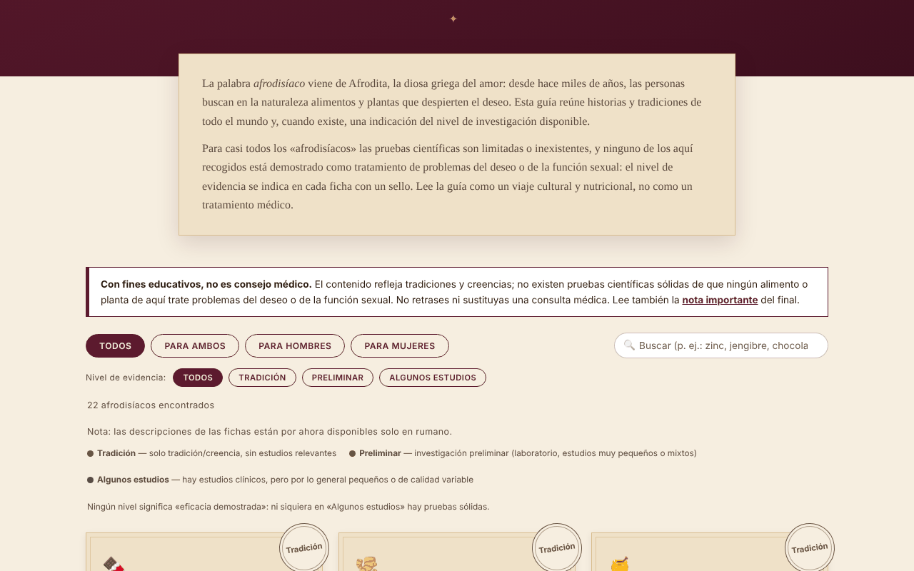

# Afrodisiace fără frontiere

[English](README.md) · [Română](README.ro.md) · [Français](README.fr.md) · [Italiano](README.it.md) · **Español** · [Português](README.pt.md) · [Deutsch](README.de.md) · [Magyar](README.hu.md)

**Versión:** 1.2.5 · **Última actualización:** 2026-10-23

Idiomas de la interfaz: **Română, English, Français, Italiano, Español, Português (PT), Deutsch, Magyar**

Compendio cultural y botánico de 22 alimentos y plantas asociados tradicionalmente con el deseo, con el nivel de evidencia indicado en cada entrada. Un solo archivo HTML, sin conexión.

**En línea:** https://chiuta.github.io/Afrodisiace-fara-frontiere/

## Qué es

Una guía educativa y cultural: 22 entradas (10 para ambos, 6 para hombres, 6 para mujeres), cada una con una breve historia/tradición y un sello del nivel de evidencia: «Tradición», «Preliminar» o «Algunos estudios». Ningún nivel significa «eficacia demostrada». No es consejo médico.

## Funciones

- Lista de 22 entradas, filtrable por público (Todos / Para ambos / Para hombres / Para mujeres).
- Filtro adicional por nivel de evidencia (Tradición / Preliminar / Algunos estudios), combinable con el público y la búsqueda; botón «Restablecer filtros» cuando no hay resultados; la tecla `/` lleva el cursor a la búsqueda.
- Tema oscuro automático (`prefers-color-scheme: dark`) y estilo de impresión (sin controles ni generador).
- Búsqueda en nombres y descripciones, sin distinguir diacríticos ni mayúsculas (p. ej., «sofran» encuentra «Șofranul»).
- Secciones «¿Cómo funciona en realidad?» (mecanismos invocados, con reservas) y «Más allá de los alimentos» (sueño, movimiento, estrés, alcohol, relación).
- «Generador de velada romántica»: elige 3 entradas al azar (barajado de Fisher–Yates) como ideas culinarias, no como tratamiento.
- Una nota de advertencia visible encima de la lista y una nota detallada al final (interacciones con medicamentos, embarazo, causas médicas).

## Manual de uso

1. Lee la nota «Educativo, no consejo médico» encima de la lista.
2. Elige el público con los botones de filtro o escribe en el cuadro de búsqueda.
3. Lee el sello de cada entrada (la leyenda está encima de la lista) y su texto.
4. Opcional: pulsa «Sorpréndeme» para obtener tres ideas al azar.
5. Antes de tomar cualquier suplemento, lee la «Nota importante» y consúltalo con tu médico o farmacéutico.

## Privacidad y red

- No usa `localStorage`, `sessionStorage`, IndexedDB ni cookies.
- No realiza llamadas de red ni carga recursos externos; no contiene enlaces externos. La política CSP de la página prohíbe las conexiones externas y solo permite el script propio, mediante hash (sin `'unsafe-inline'` para scripts).
- No solicita permisos al navegador.

## Límites y advertencias

- **Contenido educativo y cultural, no consejo médico.** Describe tradiciones y creencias; no existen pruebas científicas sólidas de que ningún alimento o planta de la lista trate problemas de deseo o de función sexual.
- No retrases la consulta médica ni sustituyas un tratamiento prescrito. Los problemas persistentes o repentinos pueden tener causas médicas.
- Los suplementos de plantas pueden interactuar con medicamentos y no se controlan como los medicamentos; evítalos durante el embarazo o la lactancia sin autorización médica.
- Los textos son resúmenes editoriales escritos por el autor; las afirmaciones sobre estudios son generales, sin referencias bibliográficas, y no se han verificado sistemáticamente con fuentes primarias en este repositorio.
- La guía está dirigida a adultos.

## Uso local / sin conexión

Descarga `index.html` y ábrelo en un navegador; no necesita internet.

## Licencia

MIT — consulta el archivo LICENSE.

## Autor

Alexio — Alexandru-Ionuț Chiuță, contacto: alexio@trom.tf

## Resumen

Un compendio en rumano, en un solo archivo y sin conexión, de 22 alimentos y hierbas asociados tradicionalmente con el deseo. Cada entrada lleva una insignia de nivel de evidencia (tradición / preliminar / algunos estudios pequeños); ninguna se presenta como demostrada. La búsqueda ignora los diacríticos, el selector aleatorio usa un barajado de Fisher–Yates y se muestra un aviso médico encima de la lista. Sin almacenamiento, sin llamadas de red, sin recursos externos. Solo con fines educativos, no es consejo médico. Licencia: MIT (consulta el archivo LICENSE).

## Historial / Changelog

- 1.2.4 — 2026-10-22: fff-kit 1.1.4: objetivos táctiles y tamaño mínimo de texto
- 1.2.3 — 2026-10-22: fff-kit 1.1.2: PBKDF2 600 000 iteraciones, protección anti-clickjacking
- 1.2.2 — 2026-10-22: Los sellos, los filtros y la leyenda usan texto de al menos 12 px; enlaces del pie de página de al menos 24 px de alto.

- 1.1.0 — 2026-10-14: copia de seguridad y etiquetado de datos (fff-kit).
- 1.0.0 — 2026-10-12: la versión y la fecha de la última actualización se muestran en la aplicación
- **11 de octubre de 2026** (ronda 7) — nueva sección «Dónde seguir verificando» con dos enlaces a páginas informativas para el público (NCCIH — Herbs at a Glance; NIH Office of Dietary Supplements — hojas informativas), cuya existencia se confirmó mediante una búsqueda web en octubre de 2026; el texto aclara que las hojas no citan estudios individuales. No se añadió contenido médico nuevo; la aplicación sigue en un solo idioma (RO), porque traducir los textos sobre evidencias/advertencias introduciría contenido clínico sin verificar. 0 errores, axe 0 violaciones a 1280×800 y 360×740.
- **11 de octubre de 2026** — filtro por nivel de evidencia, «Restablecer filtros», atajo `/`, tema oscuro, estilo de impresión; CSP con hash del script en lugar de `'unsafe-inline'`. No se añadió contenido médico nuevo; los textos de las entradas no han cambiado.
- **11 de octubre de 2026** — orden de los títulos corregido (había aparecido un `h2` oculto visualmente «Alimentos y plantas» antes de las tarjetas, y los subtítulos «¿Cómo funciona en realidad?» son `h3` en lugar de `h4`, sin cambio visible); axe-core: 0 violaciones a 1280×800 y 360×740; verificado que el filtro de búsqueda funciona. El contenido (los niveles de evidencia) no se modificó; la aplicación no tiene número de versión.
