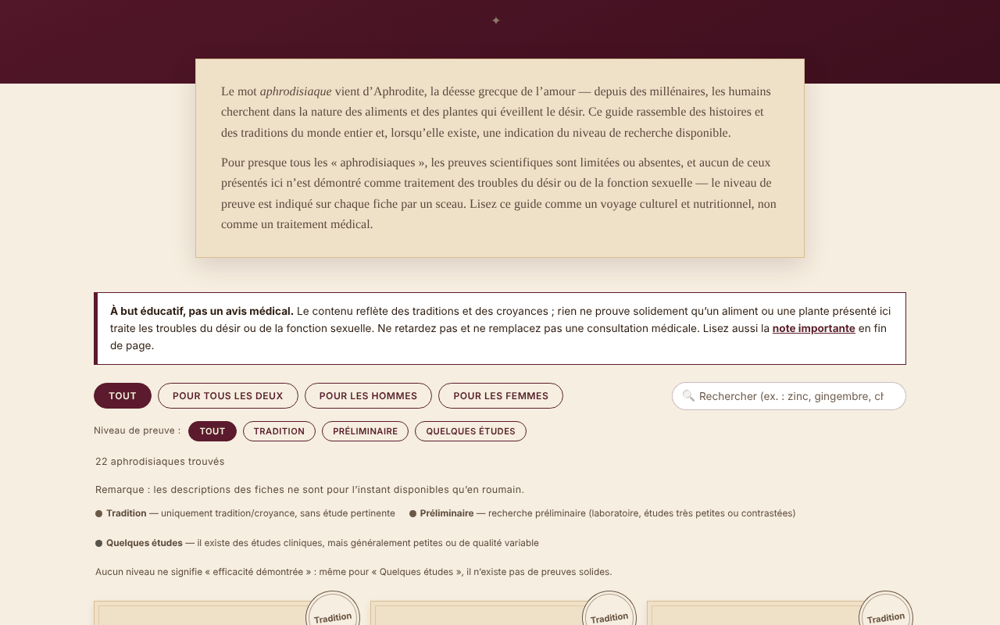

# Afrodisiace fără frontiere

[English](README.md) · [Română](README.ro.md) · **Français** · [Italiano](README.it.md) · [Español](README.es.md) · [Português](README.pt.md) · [Deutsch](README.de.md) · [Magyar](README.hu.md)

**Version :** 1.2.7 · **Dernière mise à jour :** 2026-10-26

Langues de l'interface : **Română, English, Français, Italiano, Español, Português (PT), Deutsch, Magyar**

Compendium culturel et botanique de 22 aliments et plantes traditionnellement associés au désir, avec le niveau de preuve indiqué pour chaque entrée. Un seul fichier HTML, hors ligne.

**En ligne :** https://chiuta.github.io/Afrodisiace-fara-frontiere/

## De quoi s'agit-il

Un guide éducatif et culturel : 22 entrées (10 pour les deux, 6 pour les hommes, 6 pour les femmes), chacune avec une courte histoire/tradition et un sceau du niveau de preuve : « Tradition », « Préliminaire » ou « Quelques études ». Aucun niveau ne signifie « efficacité prouvée ». Ce n'est pas un conseil médical.

## Fonctionnalités

- Liste de 22 entrées, filtrable par public (Tous / Pour les deux / Pour les hommes / Pour les femmes).
- Filtre supplémentaire par niveau de preuve (Tradition / Préliminaire / Quelques études), combinable avec le public et la recherche ; bouton « Réinitialiser les filtres » lorsqu'il n'y a aucun résultat ; la touche `/` place le curseur dans la recherche.
- Thème sombre automatique (`prefers-color-scheme: dark`) et style d'impression (sans les commandes ni le générateur).
- Recherche dans les noms et les descriptions, insensible aux diacritiques et à la casse (p. ex. « sofran » trouve « Șofranul »).
- Sections « Comment ça marche, en réalité ? » (mécanismes invoqués, avec des réserves) et « Au-delà des aliments » (sommeil, mouvement, stress, alcool, relation).
- « Générateur de soirée romantique » : choisit 3 entrées au hasard (mélange de Fisher–Yates) comme idées culinaires, et non comme traitement.
- Un avertissement visible au-dessus de la liste et une note détaillée à la fin (interactions médicamenteuses, grossesse, causes médicales).

## Mode d'emploi

1. Lisez la note « Éducatif, pas un conseil médical » au-dessus de la liste.
2. Choisissez le public avec les boutons de filtre ou saisissez un terme dans la zone de recherche.
3. Lisez le sceau de chaque entrée (la légende est au-dessus de la liste) et son texte.
4. Facultatif : appuyez sur « Surprenez-moi » pour obtenir trois idées au hasard.
5. Avant de prendre un complément, lisez la « Note importante » et parlez-en à votre médecin ou à votre pharmacien.

## Confidentialité et réseau

- N'utilise ni `localStorage`, ni `sessionStorage`, ni IndexedDB, ni cookies.
- Ne fait aucun appel réseau et ne charge aucune ressource externe ; ne contient aucun lien externe. La politique CSP de la page interdit les connexions externes et n'autorise que son propre script, par empreinte (sans `'unsafe-inline'` pour les scripts).
- Ne demande aucune autorisation au navigateur.

## Limites et avertissements

- **Contenu éducatif et culturel, pas un conseil médical.** Il décrit des traditions et des croyances ; il n'existe aucune preuve scientifique solide qu'un aliment ou une plante de la liste traite des problèmes de désir ou de fonction sexuelle.
- Ne retardez pas une consultation médicale et ne remplacez pas un traitement prescrit. Des problèmes persistants ou soudains peuvent avoir des causes médicales.
- Les compléments à base de plantes peuvent interagir avec des médicaments et ne sont pas contrôlés comme des médicaments ; évitez-les pendant la grossesse ou l'allaitement sans avis médical.
- Les textes sont des synthèses éditoriales rédigées par l'auteur ; les affirmations sur les études sont générales, sans références bibliographiques, et n'ont pas été systématiquement vérifiées sur des sources primaires dans ce dépôt.
- Le guide s'adresse aux adultes.

## Utilisation locale / hors ligne

Téléchargez `index.html` et ouvrez-le dans un navigateur ; aucune connexion Internet n'est nécessaire.

## Licence

MIT — voir le fichier LICENSE.

## Auteur

Alexio — Alexandru-Ionuț Chiuță, contact : alexio@trom.tf

## Résumé

Un compendium en roumain, en un seul fichier et hors ligne, de 22 aliments et plantes traditionnellement associés au désir. Chaque entrée porte un badge de niveau de preuve (tradition / préliminaire / quelques petites études) ; aucune n'est présentée comme prouvée. La recherche ignore les diacritiques, le tirage aléatoire utilise un mélange de Fisher–Yates et une bannière d'avertissement médical s'affiche au-dessus de la liste. Aucun stockage, aucun appel réseau, aucune ressource externe. À visée éducative uniquement, pas un conseil médical. Licence : MIT (voir le fichier LICENSE).

## Historique / Changelog

- 1.2.6 — 2026-10-23 : Les clés de stockage portent désormais le préfixe de l'application (`afrodisiace-fara-frontiere.lang`) ; les données existantes (langue) sont migrées automatiquement au démarrage, et les anciennes copies `.fff.json` restent importables. fff-kit 1.2.0 : stockage sans préfixe corrigé
- 1.2.4 — 2026-10-22 : fff-kit 1.1.4 : cibles tactiles et taille de texte minimale
- 1.2.3 — 2026-10-22 : fff-kit 1.1.2 : PBKDF2 600 000 itérations, protection anti-clickjacking
- 1.2.2 — 2026-10-22: Les tampons, les filtres et la légende utilisent un texte d'au moins 12 px; liens du pied de page d'au moins 24 px de haut.

- 1.1.0 — 2026-10-14 : sauvegarde et étiquetage des données (fff-kit).
- 1.0.0 — 2026-10-12 : la version et la date de la dernière mise à jour sont affichées dans l'application
- **11 octobre 2026** (tour 7) — nouvelle section « Où vérifier ensuite » avec deux liens vers des pages d'information destinées au public (NCCIH — Herbs at a Glance ; NIH Office of Dietary Supplements — fiches d'information), dont l'existence a été confirmée par une recherche web en octobre 2026 ; le texte précise que ces fiches ne citent pas d'études individuelles. Aucun nouveau contenu médical n'a été ajouté ; l'application reste dans une seule langue (RO), car traduire les textes sur les preuves et les avertissements introduirait un contenu clinique non vérifié. 0 erreur, axe 0 violation à 1280×800 et 360×740.
- **11 octobre 2026** — filtre par niveau de preuve, « Réinitialiser les filtres », raccourci `/`, thème sombre, style d'impression ; CSP avec empreinte du script au lieu de `'unsafe-inline'`. Aucun nouveau contenu médical n'a été ajouté ; les textes des entrées sont inchangés.
- **11 octobre 2026** — ordre des titres corrigé (un `h2` masqué visuellement « Aliments et plantes » était apparu avant les cartes, et les sous-titres « Comment ça marche, en réalité ? » sont des `h3` au lieu de `h4`, sans changement visible) ; axe-core : 0 violation à 1280×800 et 360×740 ; vérifié que le filtre de recherche fonctionne. Le contenu (les niveaux de preuve) n'a pas été modifié ; l'application n'a pas de numéro de version.
