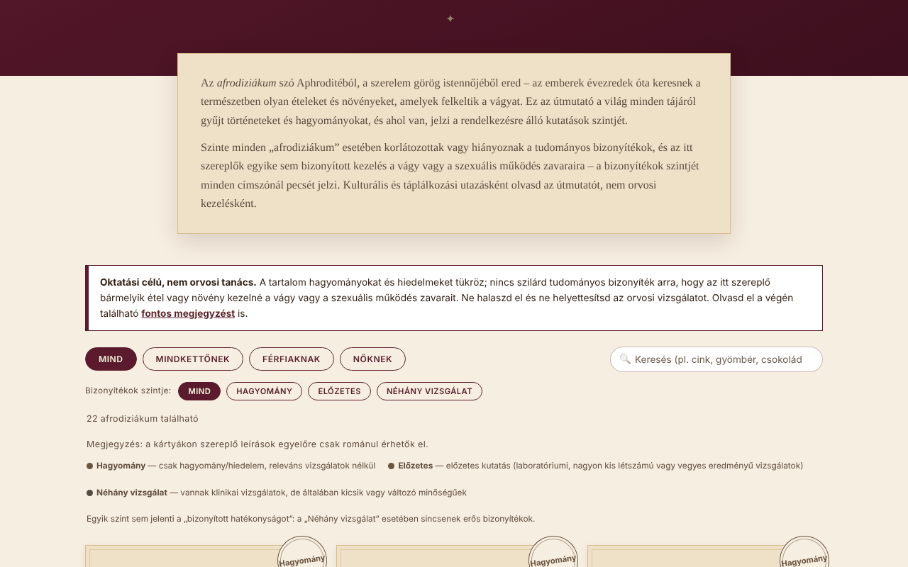

# Afrodisiace fără frontiere

[English](README.md) · [Română](README.ro.md) · [Français](README.fr.md) · [Italiano](README.it.md) · [Español](README.es.md) · [Português](README.pt.md) · [Deutsch](README.de.md) · **Magyar**

**Verzió:** 1.2.5 · **Utolsó frissítés:** 2026-10-23

A felület nyelvei: **Română, English, Français, Italiano, Español, Português (PT), Deutsch, Magyar**

Kulturális és botanikai kompendium 22 olyan ételről és növényről, amelyeket hagyományosan a vágyhoz kötnek, minden bejegyzésnél feltüntetett bizonyítékszinttel. Egyetlen HTML-fájl, offline.

**Élő verzió:** https://chiuta.github.io/Afrodisiace-fara-frontiere/

## Mi ez

Oktató és kulturális útmutató: 22 bejegyzés (10 mindkettőjüknek, 6 férfiaknak, 6 nőknek), mindegyikhez rövid történet/hagyomány és a bizonyítékszint pecsétje tartozik: „Hagyomány”, „Előzetes” vagy „Néhány tanulmány”. Egyik szint sem jelent „bizonyítottan hatásos”-t. Nem orvosi tanács.

## Funkciók

- 22 bejegyzésből álló lista, közönség szerint szűrhető (Mind / Mindkettőjüknek / Férfiaknak / Nőknek).
- További szűrő a bizonyítékszint szerint (Hagyomány / Előzetes / Néhány tanulmány), amely kombinálható a közönséggel és a kereséssel; „Szűrők visszaállítása” gomb, ha nincs találat; a `/` billentyű a keresőmezőbe viszi a kurzort.
- Automatikus sötét téma (`prefers-color-scheme: dark`) és nyomtatási stílus (vezérlők és generátor nélkül).
- Keresés a nevekben és a leírásokban, ékezet- és kis-/nagybetű-független (pl. a „sofran” megtalálja a „Șofranul” bejegyzést).
- „Hogyan működik valójában?” (hivatkozott mechanizmusok, fenntartásokkal) és „Az ételeken túl” (alvás, mozgás, stressz, alkohol, párkapcsolat) szakaszok.
- „Romantikus esték generátora”: véletlenszerűen kiválaszt 3 bejegyzést (Fisher–Yates-keverés) konyhai ötletként, nem kezelésként.
- Jól látható figyelmeztetés a lista felett és részletes megjegyzés a végén (gyógyszer-kölcsönhatások, terhesség, orvosi okok).

## Használati útmutató

1. Olvasd el az „Oktató jellegű, nem orvosi tanács” megjegyzést a lista felett.
2. Válaszd ki a közönséget a szűrőgombokkal, vagy írj a keresőmezőbe.
3. Olvasd el az egyes bejegyzések pecsétjét (a jelmagyarázat a lista felett van) és a szövegét.
4. Opcionális: nyomd meg a „Lepj meg” gombot három véletlenszerű ötletért.
5. Bármilyen étrend-kiegészítő szedése előtt olvasd el a „Fontos megjegyzést”, és beszélj az orvosoddal vagy a gyógyszerészeddel.

## Adatvédelem és hálózat

- Nem használ `localStorage`-t, `sessionStorage`-t, IndexedDB-t vagy sütiket.
- Nem indít hálózati hívásokat és nem tölt be külső erőforrásokat; nem tartalmaz külső hivatkozásokat. Az oldal CSP-szabályzata tiltja a külső kapcsolatokat, és csak a saját szkriptet engedi, hash alapján (a szkriptekhez nincs `'unsafe-inline'`).
- Nem kér böngészőengedélyeket.

## Korlátok és figyelmeztetések

- **Oktató és kulturális tartalom, nem orvosi tanács.** Hagyományokat és hiedelmeket ír le; nincs szilárd tudományos bizonyíték arra, hogy a listán szereplő bármely étel vagy növény kezelné a vágy vagy a szexuális működés zavarait.
- Ne halaszd el az orvosi vizsgálatot, és ne helyettesíts vele felírt kezelést. A tartós vagy hirtelen jelentkező problémáknak orvosi okai lehetnek.
- A növényi étrend-kiegészítők kölcsönhatásba léphetnek gyógyszerekkel, és nem ellenőrzik őket úgy, mint a gyógyszereket; terhesség és szoptatás alatt orvosi jóváhagyás nélkül kerüld őket.
- A szövegek a szerző által írt szerkesztői összefoglalók; a tanulmányokra vonatkozó állítások általánosak, irodalmi hivatkozások nélkül, és ebben a tárolóban nem ellenőrizték őket rendszeresen elsődleges forrásokkal.
- Az útmutató felnőtteknek szól.

## Helyi / offline futtatás

Töltsd le az `index.html` fájlt, és nyisd meg egy böngészőben; nincs szükség internetre.

## Licenc

MIT — lásd a LICENSE fájlt.

## Szerző

Alexio — Alexandru-Ionuț Chiuță, elérhetőség: alexio@trom.tf

## Összefoglaló

Egyfájlos, offline, román nyelvű kompendium 22, hagyományosan a vággyal összekapcsolt ételről és gyógynövényről. Minden bejegyzés bizonyítékszint-jelvényt visel (hagyomány / előzetes / néhány kis tanulmány); egyiket sem mutatják be bizonyítottként. A keresés figyelmen kívül hagyja az ékezeteket, a véletlenszerű választó Fisher–Yates-keverést használ, és a lista felett orvosi felelősségkizáró sáv látható. Nincs tárolás, nincsenek hálózati hívások, nincsenek külső erőforrások. Kizárólag oktatási célú, nem orvosi tanács. Licenc: MIT (lásd a LICENSE fájlt).

## Előzmények / Changelog

- 1.2.4 — 2026-10-22: fff-kit 1.1.4: érintési célpontok és minimális szövegméret
- 1.2.3 — 2026-10-22: fff-kit 1.1.2: PBKDF2 600 000 iteráció, clickjacking elleni védelem
- 1.2.2 — 2026-10-22: A bélyegek, a szűrők és a jelmagyarázat legalább 12 px-es szöveget használ; legalább 24 px magas lábléclinkek.

- 1.1.0 — 2026-10-14: biztonsági mentés és adatcímkézés (fff-kit).
- 1.0.0 — 2026-10-12: a verzió és az utolsó frissítés dátuma megjelenik az alkalmazásban
- **2026. október 11.** (7. kör) — új „Hol ellenőrizhetsz tovább” szakasz két hivatkozással a nagyközönségnek szóló tájékoztató oldalakra (NCCIH — Herbs at a Glance; NIH Office of Dietary Supplements — tájékoztató lapok), amelyek létezését 2026 októberében webes kereséssel igazolták; a szöveg leszögezi, hogy a lapok nem idéznek egyedi tanulmányokat. Új orvosi tartalom nem került be; az alkalmazás egynyelvű (RO) marad, mert a bizonyítékokról/figyelmeztetésekről szóló szövegek lefordítása ellenőrizetlen klinikai tartalmat vezetne be. 0 hiba, axe 0 szabálysértés 1280×800 és 360×740 mellett.
- **2026. október 11.** — szűrő a bizonyítékszint szerint, „Szűrők visszaállítása”, a `/` gyorsbillentyű, sötét téma, nyomtatási stílus; CSP a szkript hash-ével az `'unsafe-inline'` helyett. Új orvosi tartalom nem került be; a bejegyzések szövege változatlan.
- **2026. október 11.** — a címsorok sorrendje javítva (a kártyák előtt megjelent egy vizuálisan rejtett „Ételek és növények” `h2`, a „Hogyan működik valójában?” alcímek pedig `h4` helyett `h3`-ak, látható változás nélkül); axe-core: 0 szabálysértés 1280×800 és 360×740 mellett; ellenőrizve, hogy a keresőszűrő működik. A tartalom (a bizonyítékszintek) nem módosult; az alkalmazásnak nincs verziószáma.
