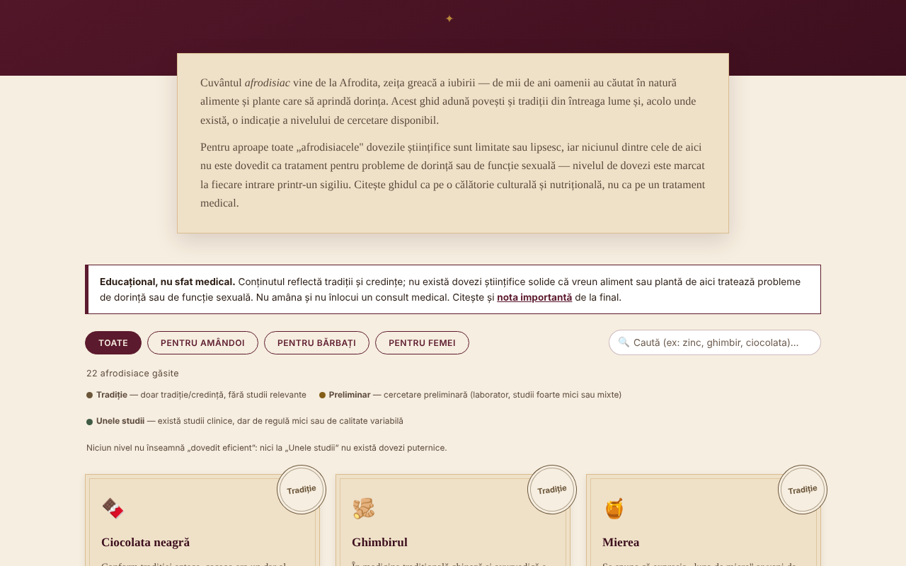

# Afrodisiace fără frontiere

**English** · [Română](README.ro.md) · [Français](README.fr.md) · [Italiano](README.it.md) · [Español](README.es.md) · [Português](README.pt.md) · [Deutsch](README.de.md) · [Magyar](README.hu.md)

**Version:** 1.1.0 · **Last updated:** 2026-10-14

A cultural and botanical compendium of 22 foods and plants traditionally associated with desire, with the level of evidence marked on every entry. A single HTML file, offline.

**Live:** https://chiuta.github.io/Afrodisiace-fara-frontiere/

## What it is

An educational and cultural guide: 22 entries (10 for both, 6 for men, 6 for women), each with a short story/tradition and an evidence seal: "Tradition", "Preliminary" or "Some studies". No level means "proven effective". It is not medical advice.

## Features

- List of 22 entries, filterable by audience (All / For both / For men / For women).
- An additional filter by evidence level (Tradition / Preliminary / Some studies), combinable with the audience and the search; a "Reset filters" button when there are no results; the `/` key moves the cursor to the search box.
- Automatic dark theme (`prefers-color-scheme: dark`) and a print style (without controls and generator).
- Search in names and descriptions, insensitive to diacritics and capital letters (e.g. "sofran" finds "Șofranul").
- Sections "How does it actually work?" (invoked mechanisms, with reservations) and "Beyond foods" (sleep, exercise, stress, alcohol, relationship).
- "Romantic evening generator": picks 3 entries at random (Fisher–Yates shuffle) as culinary ideas, not as treatment.
- A visible warning note above the list and a detailed note at the end (drug interactions, pregnancy, medical causes).

## User guide

1. Read the "Educational, not medical advice" note above the list.
2. Choose the audience with the filter buttons or type in the search box.
3. Read the seal of each entry (the legend is above the list) and its text.
4. Optional: press "Surprise me" for three random ideas.
5. Before taking any supplement, read "Important note" and talk to your doctor or pharmacist.

## Privacy and network

- It does not use `localStorage`, `sessionStorage`, IndexedDB or cookies.
- It makes no network calls and loads no external resources; it contains no external links. The page's CSP policy forbids external connections and allows only the page's own script, by hash (without `'unsafe-inline'` for scripts).
- It requests no browser permissions.

## Limits and warnings

- **Educational and cultural content, not medical advice.** It describes traditions and beliefs; there is no solid scientific evidence that any food or plant on the list treats problems of desire or sexual function.
- Do not delay medical consultation and do not replace a prescribed treatment. Persistent or sudden problems may have medical causes.
- Herbal supplements can interact with medicines and are not controlled like medicines; avoid them during pregnancy/breastfeeding without medical approval.
- The texts are editorial summaries written by the author; the statements about studies are general, without bibliographic references, and have not been systematically checked against primary sources in this repository.
- The guide is intended for adults.

## Local / offline use

Download `index.html` and open it in a browser; it needs no internet.

## License

MIT — see the LICENSE file.

## Author

Alexio — Alexandru-Ionuț Chiuță, contact: alexio@trom.tf

## Summary

A single-file, offline Romanian-language compendium of 22 foods and herbs traditionally associated with desire. Each entry carries an evidence badge (tradition / preliminary / some small studies); none is presented as proven. Search ignores diacritics, the random picker uses a Fisher–Yates shuffle, and a medical-disclaimer banner is shown above the list. No storage, no network calls, no external resources. Educational only, not medical advice. Licence: MIT (see the LICENSE file).

## History / Changelog

- 1.1.0 — 2026-10-14: Backup and data labelling (fff-kit).
- 1.0.0 — 2026-10-12: the version and the date of the last update are shown in the app
- **11 October 2026** (round 7) — new section "Where to check next" with two links to public-information pages (NCCIH — Herbs at a Glance; NIH Office of Dietary Supplements — fact sheets), their existence confirmed by a web search in October 2026; the text states that the fact sheets do not cite individual studies. No new medical content was added; the app remains in a single language (RO) because translating the texts on evidence/warnings would introduce unverified clinical content. 0 errors, axe 0 violations at 1280×800 and 360×740.
- **11 October 2026** — filter by evidence level, "Reset filters", the `/` shortcut, dark theme, print style; CSP with a script hash instead of `'unsafe-inline'`. No new medical content was added; the entry texts are unchanged.
- **11 October 2026** — heading order fixed (a visually hidden `h2` "Foods and plants" had appeared before the cards, and the subheadings "How does it actually work?" are `h3` instead of `h4`, with no visible change); axe-core: 0 violations at 1280×800 and 360×740; verified that the search filter works. The content (the evidence levels) was not modified; the app has no version number.
