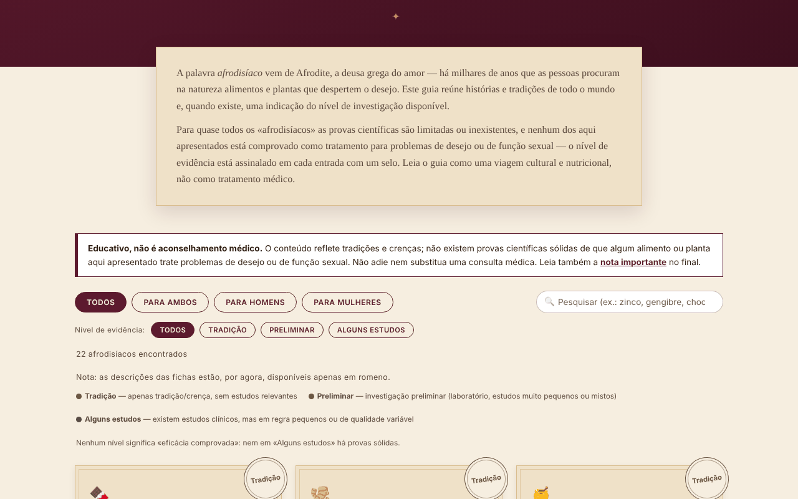

# Afrodisiace fără frontiere

[English](README.md) · [Română](README.ro.md) · [Français](README.fr.md) · [Italiano](README.it.md) · [Español](README.es.md) · **Português** · [Deutsch](README.de.md) · [Magyar](README.hu.md)

**Versão:** 2.0.0 · **Última atualização:** 2026-10-26

Idiomas da interface: **Română, English, Français, Italiano, Español, Português (PT), Deutsch, Magyar**

Compêndio cultural e botânico sobre 22 alimentos e plantas tradicionalmente associados ao desejo, com o nível de evidência assinalado em cada entrada. Um único ficheiro HTML, offline.

**Online:** https://chiuta.github.io/Afrodisiace-fara-frontiere/

## O que é

Um guia educativo e cultural: 22 entradas (10 para ambos, 6 para homens, 6 para mulheres), cada uma com uma breve história/tradição e um selo do nível de evidência: «Tradição», «Preliminar» ou «Alguns estudos». Nenhum nível significa «eficácia comprovada». Não é aconselhamento médico.

## Funcionalidades

- Lista de 22 entradas, filtrável por público (Todos / Para ambos / Para homens / Para mulheres).
- Filtro adicional por nível de evidência (Tradição / Preliminar / Alguns estudos), combinável com o público e a pesquisa; botão «Repor filtros» quando não há resultados; a tecla `/` coloca o cursor na pesquisa.
- Tema escuro automático (`prefers-color-scheme: dark`) e estilo de impressão (sem controlos nem gerador).
- Pesquisa em nomes e descrições, insensível a diacríticos e a maiúsculas/minúsculas (p. ex., «sofran» encontra «Șofranul»).
- Secções «Como funciona, na realidade?» (mecanismos invocados, com reservas) e «Para além dos alimentos» (sono, exercício, stresse, álcool, relação).
- «Gerador de serão romântico»: escolhe 3 entradas ao acaso (baralhamento de Fisher–Yates) como ideias culinárias, não como tratamento.
- Um aviso visível acima da lista e uma nota detalhada no final (interações com medicamentos, gravidez, causas médicas).

## Manual de utilização

1. Leia a nota «Educativo, não é aconselhamento médico» acima da lista.
2. Escolha o público com os botões de filtro ou escreva na caixa de pesquisa.
3. Leia o selo de cada entrada (a legenda está acima da lista) e o respetivo texto.
4. Opcional: prima «Surpreenda-me» para obter três ideias ao acaso.
5. Antes de tomar qualquer suplemento, leia a «Nota importante» e fale com o seu médico ou farmacêutico.

## Privacidade e rede

- Não utiliza `localStorage`, `sessionStorage`, IndexedDB nem cookies.
- Não faz chamadas de rede nem carrega recursos externos; não contém ligações externas. A política CSP da página proíbe ligações externas e permite apenas o script próprio, por hash (sem `'unsafe-inline'` para scripts).
- Não pede permissões ao navegador.

## Limites e avisos

- **Conteúdo educativo e cultural, não aconselhamento médico.** Descreve tradições e crenças; não existem provas científicas sólidas de que algum alimento ou planta da lista trate problemas de desejo ou de função sexual.
- Não adie a consulta médica nem substitua um tratamento prescrito. Problemas persistentes ou súbitos podem ter causas médicas.
- Os suplementos à base de plantas podem interagir com medicamentos e não são controlados como os medicamentos; evite-os na gravidez/amamentação sem parecer médico.
- Os textos são resumos editoriais escritos pelo autor; as afirmações sobre estudos são gerais, sem referências bibliográficas, e não foram verificadas sistematicamente em fontes primárias neste repositório.
- O guia destina-se a adultos.

## Utilização local / offline

Descarregue `index.html` e abra-o num navegador; não precisa de internet.

## Licença

MIT — consulte o ficheiro LICENSE.

## Autor

Alexio — Alexandru-Ionuț Chiuță, contacto: alexio@trom.tf

## Resumo

Um compêndio em romeno, num único ficheiro e offline, sobre 22 alimentos e ervas tradicionalmente associados ao desejo. Cada entrada tem um emblema de nível de evidência (tradição / preliminar / alguns pequenos estudos); nenhuma é apresentada como comprovada. A pesquisa ignora os diacríticos, o sorteio aleatório usa um baralhamento de Fisher–Yates e é exibido um aviso médico acima da lista. Sem armazenamento, sem chamadas de rede, sem recursos externos. Apenas educativo, não é aconselhamento médico. Licença: MIT (consulte o ficheiro LICENSE).

## Histórico / Changelog

- 1.2.6 — 2026-10-23: As chaves de armazenamento têm agora o prefixo da aplicação (`afrodisiace-fara-frontiere.lang`); os dados existentes (idioma) são migrados automaticamente no arranque e as cópias antigas `.fff.json` continuam a poder ser importadas. fff-kit 1.2.0: armazenamento sem prefixo corrigido
- 1.2.4 — 2026-10-22: fff-kit 1.1.4: alvos de toque e tamanho mínimo do texto
- 1.2.3 — 2026-10-22: fff-kit 1.1.2: PBKDF2 600 000 iterações, proteção anti-clickjacking
- 1.2.2 — 2026-10-22: Os selos, os filtros e a legenda usam texto de pelo menos 12 px; ligações do rodapé com pelo menos 24 px de altura.

- 1.1.0 — 2026-10-14: cópia de segurança e etiquetagem de dados (fff-kit).
- 1.0.0 — 2026-10-12: a versão e a data da última atualização são apresentadas na aplicação
- **11 de outubro de 2026** (ronda 7) — nova secção «Onde verificar a seguir» com duas ligações a páginas informativas para o público (NCCIH — Herbs at a Glance; NIH Office of Dietary Supplements — fichas informativas), cuja existência foi confirmada por pesquisa na web em outubro de 2026; o texto esclarece que as fichas não citam estudos individuais. Não foi acrescentado conteúdo médico novo; a aplicação continua num único idioma (RO), porque traduzir os textos sobre evidências/avisos introduziria conteúdo clínico não verificado. 0 erros, axe 0 violações a 1280×800 e 360×740.
- **11 de outubro de 2026** — filtro por nível de evidência, «Repor filtros», atalho `/`, tema escuro, estilo de impressão; CSP com hash do script em vez de `'unsafe-inline'`. Não foi acrescentado conteúdo médico novo; os textos das entradas não foram alterados.
- **11 de outubro de 2026** — ordem dos títulos corrigida (tinha surgido um `h2` visualmente oculto «Alimentos e plantas» antes dos cartões, e os subtítulos «Como funciona, na realidade?» são `h3` em vez de `h4`, sem alteração visível); axe-core: 0 violações a 1280×800 e 360×740; verificado que o filtro de pesquisa funciona. O conteúdo (os níveis de evidência) não foi alterado; a aplicação não tem número de versão.
